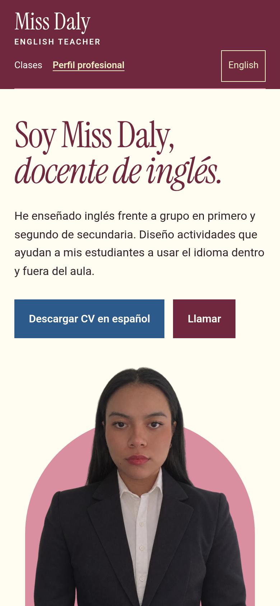
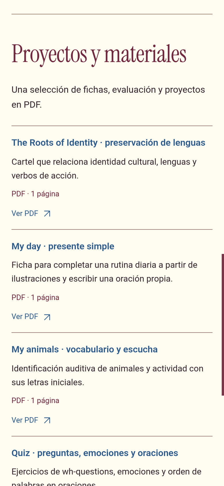

# Miss Daly

Sitio web bilingüe para una docente de inglés, desarrollado como **proyecto freelance remunerado para una clienta real**.

El proyecto reúne la oferta de clases, el perfil profesional y los materiales didácticos en una experiencia responsive en español e inglés. Forma parte de mi portafolio de diseño y desarrollo web.

## Vista previa móvil

<table>
  <tr>
    <th>Clases de inglés</th>
    <th>Perfil profesional</th>
    <th>Materiales didácticos</th>
  </tr>
  <tr>
    <td><a href="docs/screenshots/mobile-inicio.png"></a></td>
    <td><a href="docs/screenshots/mobile-perfil.png"></a></td>
    <td><a href="docs/screenshots/mobile-materiales.png"></a></td>
  </tr>
</table>

Capturas reales del sitio a 390 px de ancho. Haz clic en cada imagen para verla en detalle.

## Funcionalidades

- Páginas de clases y perfil profesional en español e inglés.
- Diseño editorial responsive con retrato e imágenes optimizadas.
- Contacto directo por WhatsApp y llamada.
- Catálogo de muestras didácticas en PDF y descarga del CV.
- Preguntas frecuentes con elementos nativos de HTML.
- Tipografías alojadas localmente.

## Tecnologías

- **Astro** para la generación del sitio estático.
- **TypeScript**, HTML y CSS para la implementación.
- **Fontsource** para las tipografías Instrument Serif y Roboto.
- **Node.js Test Runner y parse5** para las pruebas automatizadas.

## Desarrollo local

Requiere **Node.js 22.12 o posterior**.

```sh
npm ci
npm run dev
```

## Verificación y compilación

```sh
npm test
npm run check
npm run build
npm run preview
```

Las pruebas cubren las cuatro rutas, la navegación entre idiomas, los enlaces de contacto y la disponibilidad de los documentos. La compilación genera el sitio estático en `dist/`.

## Configuración

- `SITE_URL`: dominio del sitio para las URL canónicas y alternativas de idioma.
- `PUBLIC_PHONE`: reemplazo opcional del número de contacto, en formato internacional con `+` y sin espacios.

## Estructura

```text
src/
  components/   Componentes reutilizables
  layouts/      Plantillas de clases, perfil y sitio
  pages/        Rutas en español e inglés
  styles/       Estilos compartidos
public/         Imágenes, documentos y licencias tipográficas
tests/          Pruebas automatizadas
```
